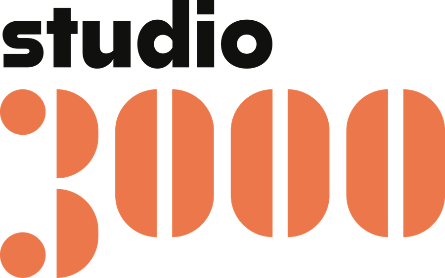

<picture>
  <source media="(prefers-color-scheme: dark)" srcset="https://raw.githubusercontent.com/studio3000be/.github/main/profile/assets/logo-dark.png">
  
</picture>

  

**Fueled by Passion, Driven by Story**

   

---

We're a videography and creative design studio based in Belgium. We help companies tell their story on screen, and we look after everything that happens after the shoot as well.

 

## What we do

- **Brand films.** Cinematic storytelling that puts your company on screen.
- **Commercials.** Short, sharp work made to convert.
- **Documentary.** Long-form content with room to breathe.
- **Post-production.** Editing, sound, and colour grading.
- **Motion & animation.** Motion graphics, titles, and animated identity.
- **Creative direction.** Strategy and concept work, from first idea to final cut.

 

## What lives here

This organisation is where we gather the technical side of the studio.

- **Tools.** Utilities we build to speed up production and delivery.
- **Websites.** Sites we design and ship, ours and our clients'.
- **Templates.** Starting points we reuse: scaffolds, configs, brand assets.

> [!NOTE]
> Nothing is published yet. Repositories will appear here as we open them up.

 

## Brand

  

Logo files live in [`profile/assets`](https://github.com/studio3000be/.github/tree/main/profile/assets).

 

---

Got a story to tell? [**info@studio3000.be**](mailto:info@studio3000.be) · [studio3000.be](https://studio3000.be)

